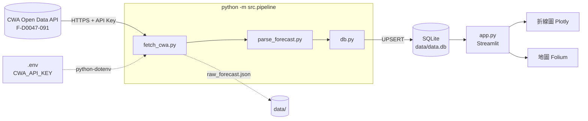
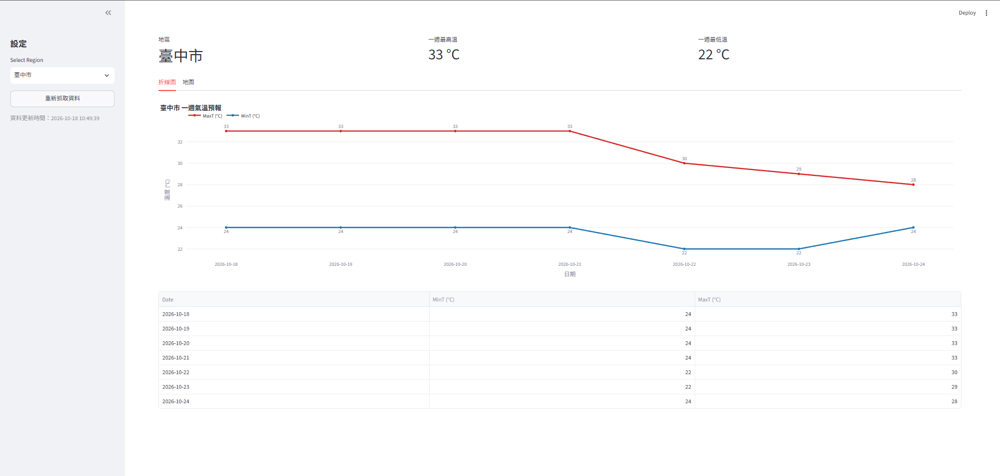

# Taiwan Weather Forecast — Forecast with CWA API

> 課程：人工智慧與資訊安全（NCHU）｜Homework 1
> 作者：郭乃瑋 Leo Kuo｜開發環境：VS Code + Claude Code（AI Agent）

以自然語言指揮 AI Agent 完成的全流程專案：從中央氣象署（CWA）開放資料平台取得**一週各縣市氣溫預報**，
解析後存入 **SQLite**，再以 **Streamlit** 建立互動式網頁（氣溫折線圖 + Folium 台灣地圖）。

## 功能

| # | 功能 | 說明 |
|---|------|------|
| F1 | 取得 CWA 一週預報 | 呼叫資料集 **F-D0047-091**（臺灣各縣市一週天氣預報），只索取「最低溫度」「最高溫度」兩個要素 |
| F2 | 解析 JSON | 從 `records.Locations[].Location[].WeatherElement[].Time[]` 抽出 regionName / dataDate / mint / maxt，日夜時段彙整成每日一筆 |
| F3 | 存入 SQLite | 資料表 `TemperatureForecasts`，`UNIQUE(regionName, dataDate)` + UPSERT，重複執行不重複插入 |
| F4 | 查詢驗證 | 筆數、地區清單、日期範圍查詢工具 |
| F5 | Streamlit Web App | 下拉選單選縣市 → MaxT（紅）/ MinT（藍）折線圖 + 資料表格，可一鍵重新抓取 |
| F6 | 台灣地圖 | Folium 地圖依日期顯示 22 縣市平均氣溫，顏色分級 <20 / 20–25 / 25–30 / >30 °C |
| F7 | 版本管理 | 每個 Phase 一個 commit，API Key 不進 git |

## 系統架構



## 專案結構

```
Forecast-with-CWA-API/
├── .env                   # CWA_API_KEY=...（不進 git）
├── .env.example           # 範本（進 git）
├── .gitignore
├── requirements.txt
├── README.md
├── pipeline.md            # 給 AI Agent 的開發流程說明（Phase 0–7）
├── app.py                 # Streamlit 主程式（折線圖 + 地圖）
├── data/
│   ├── raw_forecast.json  # API 原始回應（執行後產生，不進 git）
│   └── data.db            # SQLite 資料庫（執行後產生，不進 git）
├── src/
│   ├── config.py          # 讀取 .env、常數（URL、dataset id、縣市座標、顏色分級）
│   ├── fetch_cwa.py       # F1：呼叫 API，存 raw json
│   ├── parse_forecast.py  # F2：JSON → DataFrame
│   ├── db.py              # F3/F4：建表、UPSERT、查詢
│   └── pipeline.py        # 串接 fetch → parse → save（CLI 入口）
└── tests/
    └── test_pipeline.py   # pytest：解析與 UPSERT 測試
```

### 資料庫 Schema

```sql
CREATE TABLE IF NOT EXISTS TemperatureForecasts (
    id          INTEGER PRIMARY KEY AUTOINCREMENT,
    regionName  TEXT    NOT NULL,
    dataDate    TEXT    NOT NULL,   -- 'YYYY-MM-DD'
    mint        REAL,
    maxt        REAL,
    fetchedAt   TEXT    DEFAULT (datetime('now','localtime')),
    UNIQUE(regionName, dataDate)
);
```

## 安裝

```bash
git clone https://github.com/Kuonaiwei1126/Forecast-with-CWA-API.git
cd Forecast-with-CWA-API
python -m venv .venv
.venv\Scripts\activate          # macOS/Linux: source .venv/bin/activate
pip install -r requirements.txt
copy .env.example .env          # macOS/Linux: cp .env.example .env
```

然後編輯 `.env`，把 `CWA_API_KEY` 換成你的金鑰。金鑰請至 [CWA 開放資料平台](https://opendata.cwa.gov.tw/) 註冊後於「取得授權碼」頁面取得。

## 執行

```bash
python -m src.pipeline   # 抓取 → 解析 → 存入 data/data.db（可重複執行，不會重複插入）
streamlit run app.py     # 開啟 http://localhost:8501
pytest -q                # 執行測試
```

執行 `python -m src.pipeline` 的輸出範例：

```
地區數 22，日期 2026-10-18 ~ 2026-10-24
寫入 154 筆（UPSERT）；資料表筆數 154 -> 154（新增 0 筆）
```

## 截圖

> 請將截圖放在 `docs/` 目錄並更新下方路徑。

| 折線圖分頁 | 地圖分頁 |
|-----------|---------|
|  |  |

## AI Agent 開發流程

本專案全程以 **VS Code + Claude Code** 進行，開發者只用自然語言下指令，由 AI Agent 撰寫程式、執行、測試、commit。

1. 先撰寫 [`pipeline.md`](pipeline.md)：定義工作守則、功能需求、專案結構、資料庫 schema，並把工作拆成 Phase 0–7，每個 Phase 都有「要做的事 / 驗收標準 / commit 訊息」。
2. 對 Agent 說「請閱讀 pipeline.md，開始執行任務」。
3. Agent 逐 Phase 執行：寫程式 → 實際呼叫 API 驗證格式 → 跑測試 → `git commit` → `git push`。
4. 關鍵的「先驗證、不猜測」原則讓 Agent 在 Phase 1 就發現 CWA API 格式與 pipeline 原本假設不同（見下節），並據實調整。

### 開發過程中發現的問題與解法

| 問題 | 解法 |
|------|------|
| CWA 新版 API 的 JSON key 為大寫開頭（`Locations` / `Location` / `WeatherElement` / `Time` / `ElementValue`），與舊文件的小寫不同 | 以實際回應為準撰寫解析器，並同時容忍大小寫兩種 key |
| 參數 `elementName=MinT,MaxT` 被 API 忽略，回傳全部 15 個要素（1.6 MB） | 改用 `ElementName=最低溫度,最高溫度`（中文），回應縮小到約 80 KB |
| 溫度值在 `ElementValue[0].MinTemperature` / `MaxTemperature`，而非 `value` | 解析時以 ElementValue 內的 key 判斷要素，比靠 ElementName 更穩定 |
| 同一天有日 / 夜兩個時段 | 以 (regionName, dataDate) groupby，mint 取 min、maxt 取 max |
| Folium 預設的 CartoDB 圖磚已改為需要 API key | 改用 OpenStreetMap 圖磚 |

## 資安考量

| 項目 | 做法 |
|------|------|
| API Key 管理 | 只存在 `.env`，由 `python-dotenv` 讀取；`.env` 列於 `.gitignore`；`.env.example` 只有佔位字串；已用 `git log -p` 確認歷史中無金鑰 |
| 外部輸入驗證 | API 回應檢查 HTTP status、JSON 格式、`success` 欄位；解析時逐層做型別檢查，無法轉換的數值變 NaN 而非崩潰 |
| SQL Injection 防護 | 所有查詢使用 `?` 參數化 placeholder，不做字串拼接；有對應的 pytest 測試 |
| 網路安全 | 僅使用 HTTPS；`requests.get` 設定 `timeout=15` 避免無限等待 |
| 資料檔不進版控 | `data/data.db`、`data/raw_forecast.json` 皆在 `.gitignore` |
| 部署時的機密 | 部署到 Streamlit Community Cloud 時，金鑰放在 Streamlit Secrets（見下節） |

## 部署到 Streamlit Community Cloud（選配）

1. 到 https://share.streamlit.io 以 GitHub 登入，選擇本 repo、分支 `main`、主程式 `app.py`。
2. 在 App 的 **Settings → Secrets** 貼上：
   ```toml
   CWA_API_KEY = "你的金鑰"
   ```
   Streamlit 會把 Secrets 注入為環境變數，`src/config.py` 的 `os.getenv("CWA_API_KEY")` 可直接讀到，程式碼無需修改。
3. 首次開啟網頁時，若 `data/data.db` 不存在，App 會自動執行一次 pipeline 建立資料；之後可按側欄「重新抓取資料」更新。

## 資料來源

- 中央氣象署開放資料平台：https://opendata.cwa.gov.tw/
- 資料集 F-D0047-091：臺灣各縣市鄉鎮未來 1 週逐 12 小時天氣預報
